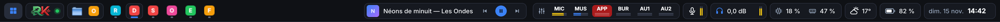
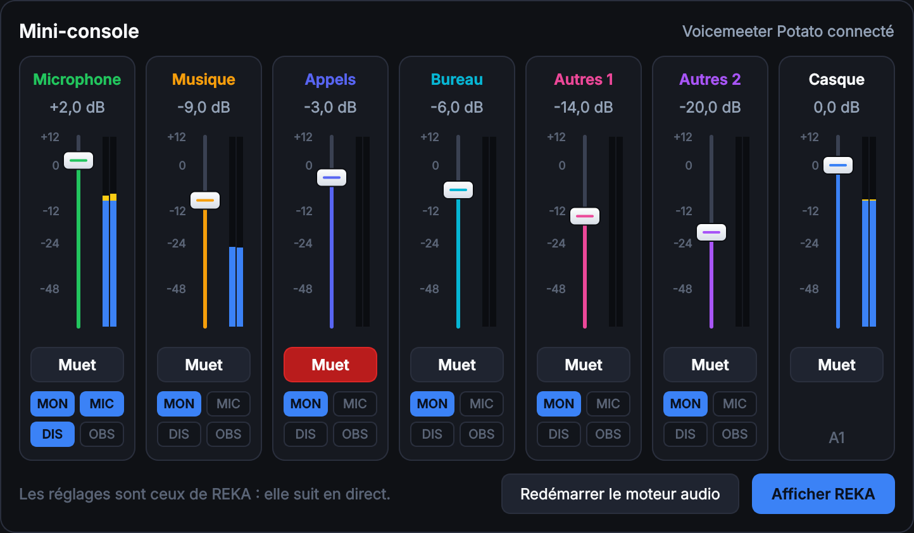
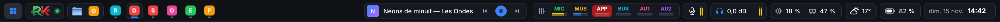
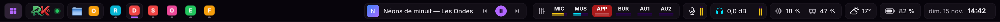

# REKA Taskbar

Une barre des tâches personnalisée pour Windows 10 / 11, avec des widgets d'usage courant et des widgets reliés à [REKA](https://github.com/1337133713377/reka), la console de mixage.



## Ce qu'elle fait

| Widget | Ce qu'il montre | Gestes  |
|---|---|---|
| **Démarrer** | le menu Démarrer de Windows | clic ; clic droit : Explorateur, Gestionnaire des tâches, verrouiller |
| **Bouton REKA** | REKA ouverte ou non, Voicemeeter connecté ou non (pastille verte / ambre / grise) | clic : affiche la console, ou la lance si elle est fermée |
| **Raccourcis** | tes programmes, dossiers et fichiers préférés | clic |
| **Fenêtres ouvertes** | une icône par fenêtre, la fenêtre active soulignée | clic : afficher / réduire · clic du milieu : fermer |
| **Musique en cours** | pochette, titre, artiste (Spotify, Deezer, navigateur…) | précédent / pause / suivant |
| **Canaux de REKA** | chaque canal de la console avec son niveau | clic : muet · molette : volume · bouton à curseurs : mini-console |
| **Micro** | micro ouvert ou coupé, et son niveau | clic : couper / rouvrir · molette : volume · raccourci clavier global |
| **Casque** | volume et niveau de la sortie casque | molette : volume · clic : muet · clic du milieu : 0 dB |
| **Processeur, mémoire** | charge en %, ambre puis rouge quand ça chauffe | clic : Gestionnaire des tâches |
| **Débit du réseau** | réception et envoi | *(non affiché par défaut)* |
| **Météo** | température et temps de ta ville | clic : actualiser *(caché tant qu'aucune ville n'est choisie)* |
| **Batterie** | niveau et autonomie | *(caché sur un PC fixe)* |
| **Horloge** | heure et date | clic : calendrier |

Chaque widget se place à gauche, au centre ou à droite, ou se retire, depuis **clic droit → Réglages de la barre → Widgets**.

## Le lien avec REKA

La barre ne modifie pas REKA : elle s'y raccorde de trois façons.

- **Sa config** (`%APPDATA%\REKA\config.json`), relue dès qu'elle change : édition de Voicemeeter, ordre et noms des canaux, knobs de routing, bus du casque, thème et couleurs. La barre montre donc les mêmes canaux, dans le même ordre, aux mêmes couleurs que la console.
- **Voicemeeter**, que REKA pilote aussi : un Muet ou un volume réglé depuis la barre apparaît aussitôt dans REKA, et l'inverse. Si la synchronisation du micro avec Discord est activée dans REKA, couper le micro depuis la barre le coupe aussi dans Discord.
- **Le canal « afficher REKA »** que la console ouvre pour ses propres relances : le bouton REKA affiche sa fenêtre, même cachée près de l'horloge.

REKA n'a pas besoin d'être ouverte pour que les canaux, le micro et le casque fonctionnent : il suffit que Voicemeeter tourne. La barre ne lance jamais Voicemeeter ; elle s'y connecte quand il démarre et se reconnecte s'il redémarre.

<table>
<tr>
<td width="62%"></td>
<td valign="top">

### Mini-console

Le bouton à curseurs ouvre les canaux de REKA sans ouvrir REKA : fader, VU-mètre, Muet et envois (Monitor, Mic Out, Discord, Obs) de chaque canal, plus le casque.

Fader : glisser (<kbd>Maj</kbd> = précis), molette, double-clic = 0 dB.

« Redémarrer le moteur audio » relance celui de Voicemeeter quand le son craque.

</td>
</tr>
</table>

Avec « Reprendre le thème et les couleurs de REKA » (activé par défaut), la barre suit la console, thème prédéfini ou couleurs par canal :




## Démarrer

1. Récupère `REKA-Taskbar.exe` : onglet **Actions** du dépôt → dernière exécution réussie de *Build Windows* → artefact **REKA-Taskbar** (ou la dernière *release* quand un tag `v…` a été poussé).
2. Lance-le : rien à installer. La barre se place en haut de l'écran ; la barre des tâches de Windows reste en bas.
3. Clic droit sur la barre → **Réglages de la barre…** pour la position, les widgets, la météo, le raccourci du micro et le démarrage avec Windows.

Pour voir la barre sans Voicemeeter ni REKA : `REKA-Taskbar.exe --demo`.

> [!NOTE]
> L'exe n'est pas signé : au premier lancement, Windows SmartScreen demande confirmation (**Informations complémentaires** → **Exécuter quand même**), comme pour REKA.

## Réglages

| Onglet | Réglages |
|---|---|
| **Barre** | en haut ou en bas, hauteur, écran, opacité, place réservée (les fenêtres agrandies s'arrêtent à la barre), passage derrière les jeux en plein écran, masquage de la barre de Windows, démarrage avec Windows |
| **Widgets** | zone et ordre de chaque widget (glisser-déposer), secondes et date de l'horloge, titres des fenêtres, ville de la météo |
| **REKA** | état du lien, thème, canal du micro, raccourci « couper le micro », emplacement de `REKA.exe` |
| **Raccourcis** | programmes, dossiers et fichiers du widget Raccourcis |

**Masquer la barre de Windows.** L'option la cache et la passe en masquage automatique ; la zone de notification (icônes près de l'horloge) disparaît avec elle. Elle revient dès que tu décoches l'option ou que tu quittes REKA Taskbar. Si elle restait cachée après un arrêt brutal, le lancement suivant la rend, ou bien : `REKA-Taskbar.exe --restore-taskbar`.

**Raccourci du micro.** Par exemple `Ctrl+Alt+M`, `F13` ou `Pause`. Il fonctionne partout, y compris en jeu.

**Météo.** Elle vient d'[Open-Meteo](https://open-meteo.com/), sans compte ni clé. Seul le nom de la ville est envoyé, et seulement s'il est renseigné.

Les réglages sont dans `%APPDATA%\REKA Taskbar\config.json`, le journal dans `app.log` à côté.

## Limites connues

- La zone de notification de Windows n'est pas reproduite : garde la barre de Windows visible si tu en as besoin.
- Les applications du Microsoft Store apparaissent avec une pastille à leur initiale au lieu de leur icône.
- Voicemeeter standard (2 entrées) est affiché sans les envois ; REKA elle-même demande Banana ou Potato.

## Pour les développeurs

```bash
cd reka_taskbar
python -m pip install -r requirements.txt pytest
python main.py --demo        # la barre avec des moteurs simulés
python -m pytest tests       # les tests
```

Même base que REKA : Python 3.11+, PySide6, PyInstaller. Voicemeeter est piloté directement par sa DLL (`ctypes`), le reste de Windows aussi (fenêtres, ancrage, raccourci clavier).

| Dossier | Contenu |
|---|---|
| `core/reka_link.py` | lecture de la config de REKA, détection, affichage et lancement de la console |
| `core/voicemeeter.py` | API Remote de Voicemeeter et thread de scrutation |
| `core/windows.py`, `core/appbar.py`, `core/winapi.py` | fenêtres ouvertes, ancrage de la barre, barre de Windows |
| `core/media.py`, `core/system.py`, `core/weather.py`, `core/shell.py` | musique, système, météo, services de Windows |
| `core/demo.py` | moteurs simulés (`--demo`, `--selftest`, tests) |
| `ui/bar.py`, `ui/widgets/` | la barre et ses widgets |
| `ui/mixer_popup.py`, `ui/settings_dialog.py` | mini-console, réglages |

Chaque push lance les tests sous Linux puis sous Windows (dont les appels Win32 réels), construit l'exe et lui fait passer son auto-test (`--selftest`).

---

**REKA** et **REKA Taskbar** sont développés par **Regrettable** et **Zerka**. La police Inter est distribuée sous licence OFL (`reka_taskbar/assets/Inter-OFL.txt`).
